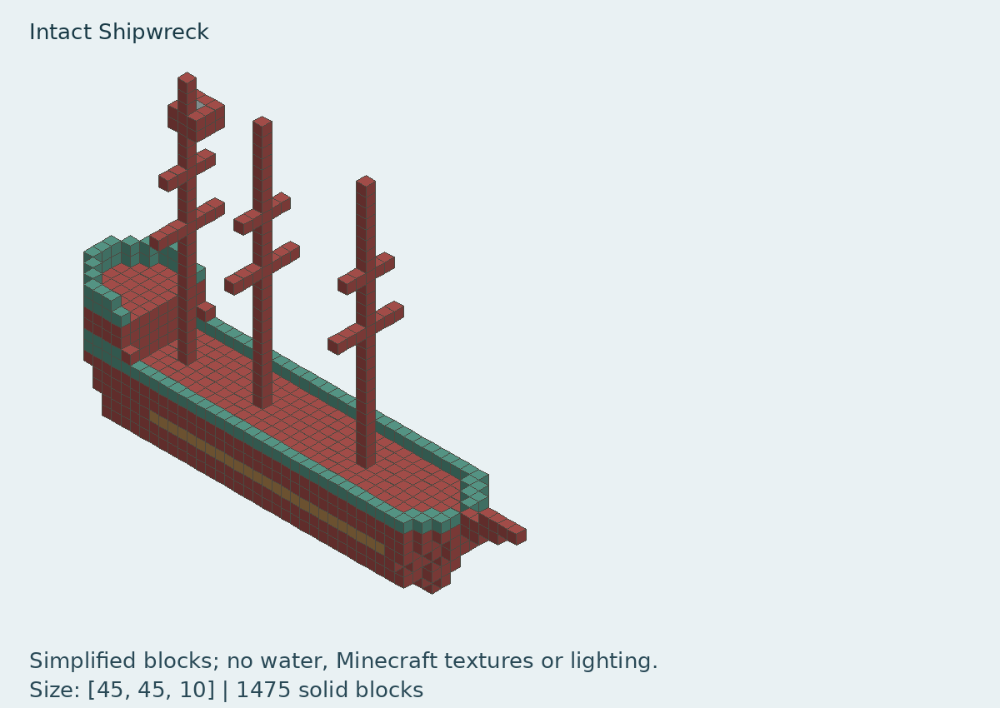
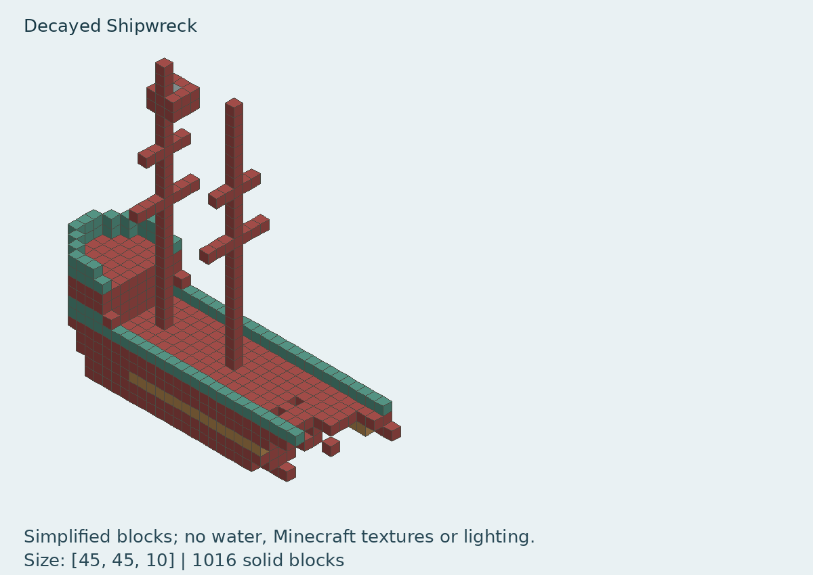
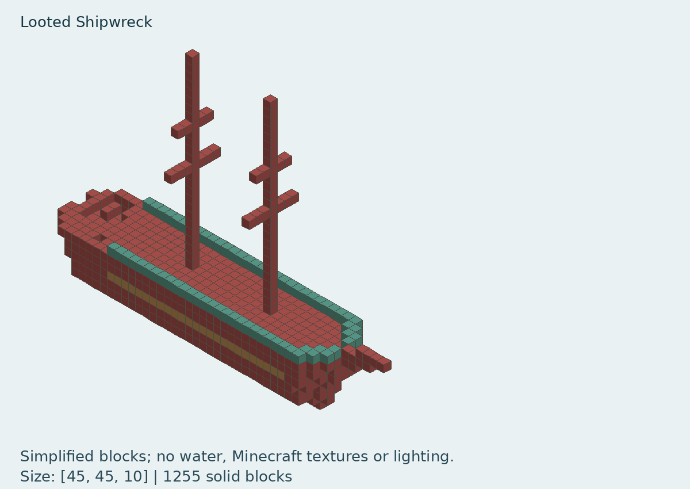

# Structure previews — not included in the addon

**[Download all three previews as a ZIP](https://github.com/zclar/endless_waters/raw/refs/heads/main/dist/Structure_Previews.zip)**

On your phone, unzip it and open the PNG pictures. This ZIP is for viewing;
it does not install anything in Minecraft.

These images are generated from actual Java NBT files, read as data without
executing the downloaded mod. They show block silhouettes with approximate
material colors. Stairs, slabs and other shapes are shown as cubes; water,
lighting, textures, entities and chest contents are omitted. They are not
Minecraft screenshots or proof of Bedrock placement compatibility.

## Legacy Boat Ruins

Source: https://github.com/425913490bb-gif/boat_ruins_mod
Archive: main branch downloaded 2026-11-02. Actual NBT SHA256 hashes and palettes
are recorded in `boat_ruins/catalog.json`. Its archive LICENSE is MIT, copyright
2026 425913490bb-gif; a full copy is included beside the previews.

| Intact | Decayed | Looted |
| --- | --- | --- |
|  |  |  |

These are candidates for review. Conversion, block-state translation, floor
placement, loot and in-game checks have not been performed. No changes to the
downloadable addon are part of this preview.
