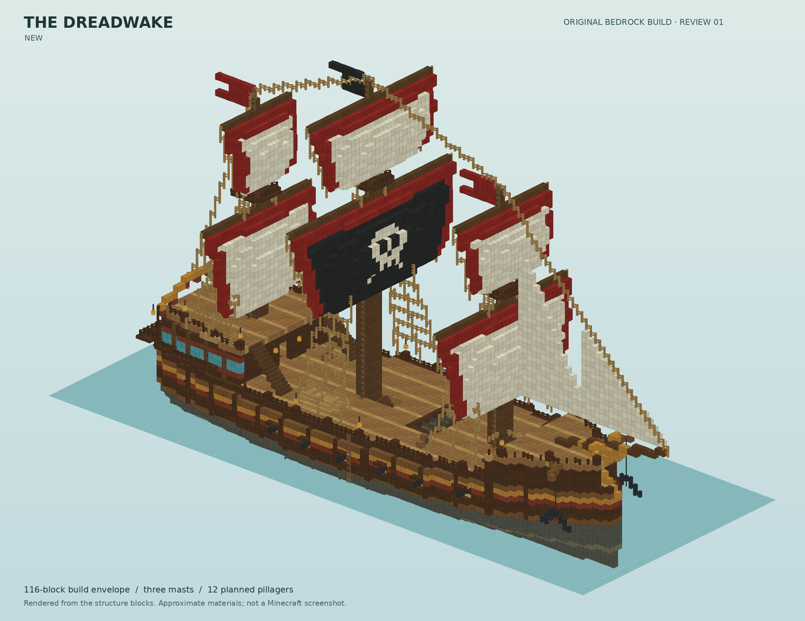
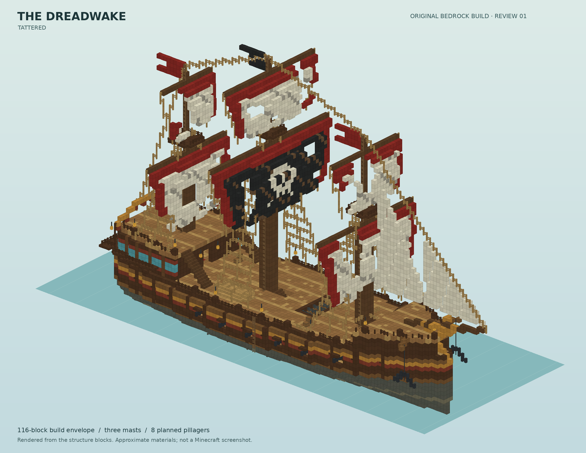
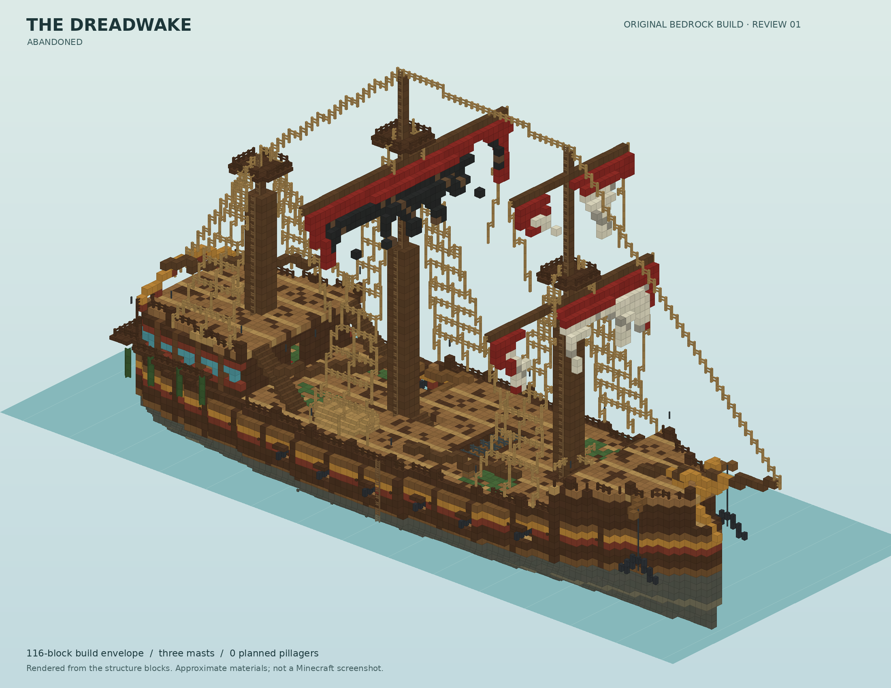
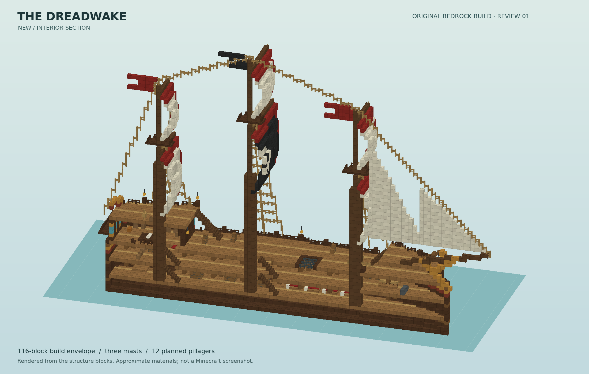
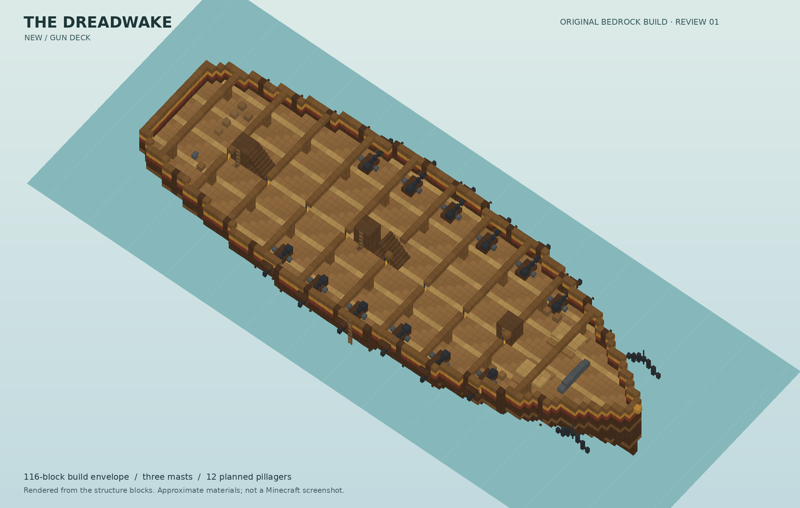
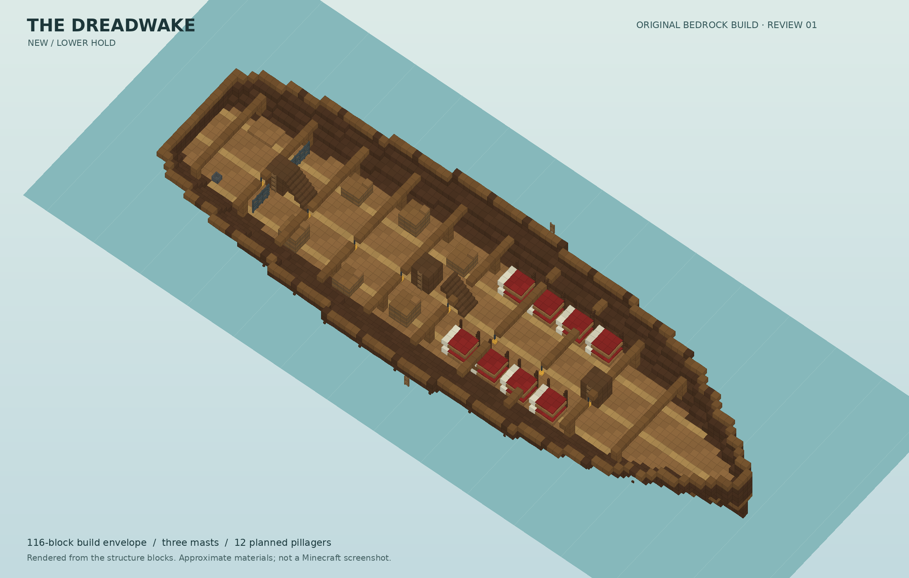
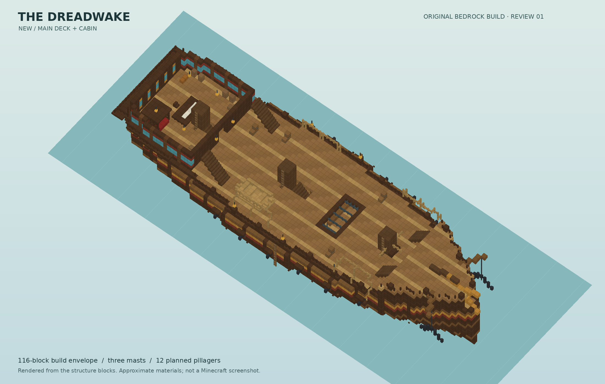

# The Dreadwake — pirate galleon, first review

**Preview only. This ship has not been added to the Endless Waters addon or
world generation.** Review the design before integration.

An original block-built galleon, **108 blocks long**, up to **43 blocks across
the sails**, with a **31-block hull beam**. The new and tattered versions are
74 blocks tall from keel to masthead; the abandoned version has broken upper
masts and is 65 blocks tall. The padded export envelope is 49 × 76 × 116.

**[Download the pictures and offline 3D viewer](https://github.com/zclar/endless_waters/raw/refs/heads/main/dist/Dreadwake_Ship_Previews.zip)**

On Android, unzip the download and open the PNG images. `VIEW_SHIP.html` is an
optional offline WebGL viewer: open it in a browser, drag to rotate and pinch
to zoom, switch variants, and use the deck selector to inspect interiors.
Some Android file apps cannot launch local HTML correctly; the PNGs need only
an image viewer. No Minecraft import is needed for these previews.

## Three conditions

| New | Tattered | Abandoned |
| --- | --- | --- |
| Complete sails, bright trim, stocked cargo areas; 12 planned pillagers | Torn and patched sails, repaired rails, weathered planking; 8 planned pillagers | Broken upper masts, hanging sail remnants, breached decking, moss, cobwebs and broken cabin windows; no crew |
| [Full-size bow view](new.png) | [Full-size bow view](tattered.png) | [Full-size bow view](abandoned.png) |
| [Full-size stern view](new_stern.png) | [Full-size stern view](tattered_stern.png) | [Full-size stern view](abandoned_stern.png) |







## Inside the ship

- Cargo hold with stacked barrels, crew bunks and an aft brig.
- Gun deck with twelve decorative cannons, galley, mess tables and workshop.
- Main deck with a cargo grating, capstan, stowed dinghy and boarding ladders.
- Captain's cabin with chart desk, bookcases, canopy bunk and storage.
- Raised forecastle and quarterdeck, stern gallery, decorative wheel,
  anchors, figurehead, crow's nests and climbable mast ladders.

| Interior section | Gun deck |
| --- | --- |
|  |  |

| Lower hold | Main deck and cabin |
| --- | --- |
|  |  |

## What the previews represent

These are renders of the actual block layouts saved in the `.mcstructure`
templates, not AI concept paintings or Minecraft screenshots. Slabs, stairs,
fences and several furniture blocks have approximate geometry. Materials use
approximate colors rather than Minecraft textures. The water plane is a visual
reference, and the viewer's crew markers represent planned pillager positions.

The furnishings, cannons, wheel and rigging are vanilla-block assemblies;
decorative bunks are not usable bed blocks. Cannons do not fire. Barrels and
chests have no assigned loot yet. No third-party structure assets are used.

## Validation and remaining work

`validation.json` records checks that each NBT piece matches its preview block
layout, all crew positions have floor/headroom, the hull is sealed below the
waterline in a voxel flood test, and the main addon download is unchanged.
Each variant is exported as two pieces within the 64-block horizontal limits.

Bedrock loading, block-state compatibility, pathfinding, ladder attachment,
mob persistence, loot and generation placement still need engine tests after
the design is accepted. The official server download timed out during this
review, so no successful in-game test is claimed. The interactive viewer is
an additional inspection tool; it is not a Bedrock simulator.

Rebuild from the repository root:

```sh
python3 tools/pirate_ship.py
python3 tools/render_pirate_ship.py
python3 tools/validate_pirate_ship.py
```
